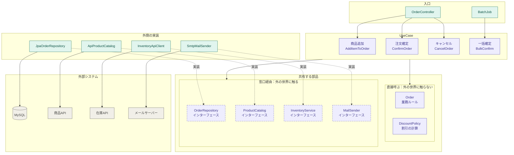

# DDD とクリーンアーキテクチャ まとめ

題材：ネットショップの「注文」（Java / Spring Boot）

（2026-11 時点の整理）

---

## 1. DDD

### 1.1 目的：業務ルールをモデルの中に閉じ込める

呼び出し側は「何をしたいか」だけを伝え、「それが許されるか、どう状態が変わるか」はモデルの中で完結させる。

### 1.2 主な用語

| 用語 | 意味 | 例 |
|---|---|---|
| ユビキタス言語 | 業務担当者と開発者が同じ言葉を使い、そのままコードの名前にする | 注文、確定、キャンセル |
| エンティティ | ID で区別されるもの | `Order` |
| 値オブジェクト | 値そのものに意味がある、不変のもの | `Money`, `Quantity` |
| 集約 | 一緒に整合性を守る単位。外からは代表（集約ルート）経由でしか触らせない | `Order` + `OrderLine` |
| リポジトリ | 集約を保存・取得する窓口 | `OrderRepository` |
| ドメインサービス | 1 つの集約に収まらない業務ルール | `DiscountPolicy` |
| 境界づけられたコンテキスト | 同じ言葉でも意味が変わる境界でモデルを分ける | 販売の「商品」と倉庫の「商品」 |

### 1.3 DTO の場合との違い：業務の言葉のメソッド

```java
// DTO の場合：getter/setter でフィールドを書き換える。ルールは呼び出し側任せ
order.setStatus(OrderStatus.CONFIRMED);
order.setConfirmedAt(LocalDateTime.now());

// ドメインモデルの場合：業務の言葉のメソッドを呼ぶ。ルールはモデルが守る
order.confirm();

public void confirm() {
    if (status != OrderStatus.DRAFT) throw new IllegalStateException("確定できない状態");
    if (lines.isEmpty())             throw new IllegalStateException("明細がない");
    status = OrderStatus.CONFIRMED;
    confirmedAt = LocalDateTime.now();
}
```

効果は 3 つ。

1. **チェックを飛ばせない**：確定する手段が `confirm()` しかない
2. **変更がまとまる**：関連するフィールドが必ずセットで変わる
3. **ありえない状態遷移を防げる**：許された遷移しか用意しない

> 中身が代入 1 行だけでルールがないなら、それは名前を変えた setter にすぎない。守りたいルールがある操作だけ業務メソッドにすれば十分。

### 1.4 DTO とドメインモデルの役割分担

| | DTO | ドメインモデル |
|---|---|---|
| 役割 | 層の境界でデータを運ぶ入れ物 | 業務ルールを守る番人 |
| 形 | API の JSON や画面に合わせる | 業務の意味に合わせる |
| 振る舞い | 持たない | 持つ |

バリデーションも 2 種類ある。

- **入力チェック（DTO）**：値だけで判定できる。「数量は 1 以上」
- **業務ルール（ドメイン）**：今の状態を見ないと判定できない。「確定済みの注文には追加できない」

```java
// DTO：形のチェック
public record AddItemRequest(
    @NotBlank String productId,
    @Min(1) @Max(99) int quantity
) {}
```

### 1.5 境界は業務側と決める

境界を気にすること自体はどんな設計でも同じ。違いは**何を基準に引くか**。

- 技術都合：画面、API、テーブル単位
- DDD：業務上、何が一緒に変わり、どのルールを同時に守る必要があるか

例：`Order` と `OrderLine` を同じ集約にするのは「明細は最大 10 件」「確定後は明細も変更不可」というルールが両方にまたがるから。これはテーブル構成からは決まらない。

---

## 2. クリーンアーキテクチャ



実線の矢印は「呼び出す」、点線の矢印は「実装する」、点線枠の箱はインターフェース。紫が内側（業務）、緑が外側（技術）、灰が外部システム。

- **ルールは 1 つ**：外側は内側を知ってよいが、内側は外側を知らない。内側から外側へ向かう矢印は 1 本もなく、外側の実装が点線で内側の窓口に合わせに来る
- **入口**：1 リクエストにつき UseCase を 1 つ呼ぶ
- **UseCase**：1 機能 = 1 クラスの台本。「取ってくる → ドメインに頼む → 保存・通知する」を並べるだけで、業務の判断はしない。UseCase 同士は呼び合わない
- **直接呼ぶ部品**：`Order` や `DiscountPolicy` のように外の世界に触らないものは普通のクラス。テストでも本物を使う
- **窓口（インターフェース）**：DB、外部 API、メールなど外の世界に触るところだけに置く
- **外側の実装**：内側の言葉と外の形（テーブルの行、JSON、メール本文）を翻訳する。外の都合はここに閉じ込める
- **config**：起動時に「この窓口にはこの実装」と配線する。テストではここを偽物に替えるだけで、内側を DB なしで動かせる

---

## 3. MVCS との違い

| 観点 | MVCS | DDD + クリーン |
|---|---|---|
| 業務ルールの場所 | Service | ドメインモデル |
| モデル | getter/setter だけ | 振る舞いとルールを持つ |
| 依存の向き | 上から下へ、最後は DB | すべて内側へ |
| DB の差し替え | Service も修正 | 外側の実装を替えるだけ |
| テスト | DB やモックが必要になりがち | ドメインは純粋な Java で書ける |
| 手間 | 少ない | クラスが増える |

ルールが少ない CRUD 中心のアプリなら MVCS で十分。Service が肥大化し、同じチェックが何か所にも重複してきたら DDD + クリーンに寄せる価値が出てくる。

---

## 4. AI 時代の落としどころ

- 書くコストは AI が肩代わりするので、ボトルネックは「人が読んで確かめる」部分
- 形だけの層やインターフェースの量産はレビュー負担を増やすだけ
- 一方、境界がはっきりしたコードは AI にも扱いやすい（渡す文脈が小さく、修正の波及が少ない）

**方針**：シンプルな構成を基本にし、業務ルールは 1 か所に集め、インターフェースは外の世界との継ぎ目だけに置く。「層の数」より「ルールがどこにあるか一目で分かるか」を基準にする。
