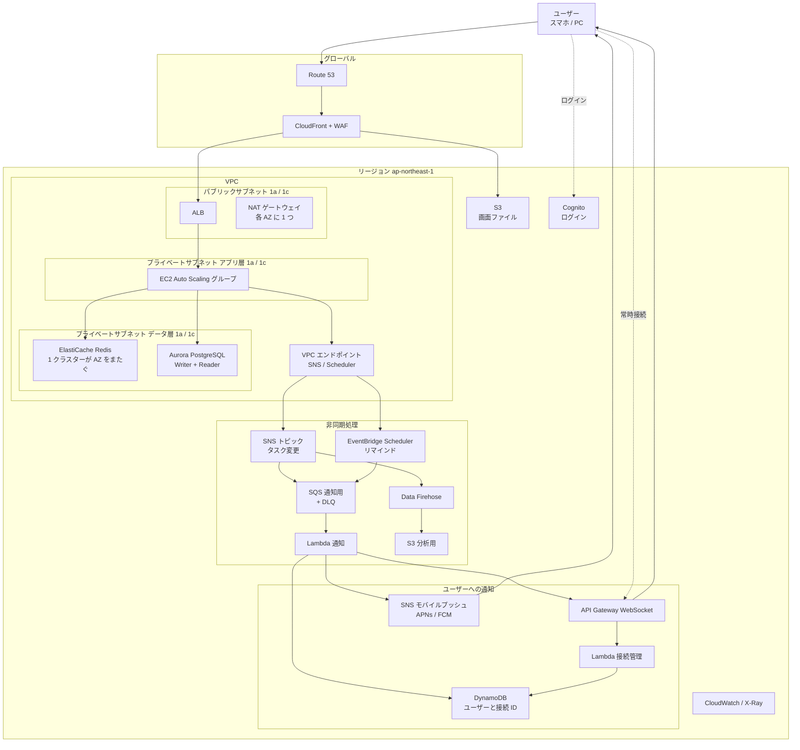

# TODO アプリのシステム設計を AWS で組む（負荷見積もりから通知・リマインドまで）

システム設計の試験問題「TODO アプリを設計する」を題材に、負荷の見積もりから AWS の構成、非同期処理・通知・リマインドまでを、部品ごとの選んだ理由と一緒に整理したもの。試験では「何を置いたか」より「なぜ置いたか」を説明文に書けるかが評価される。

（2026-11 時点の整理）

## 1. 問題の条件

- 登録ユーザー約 1000 万人、そのうち半分以上が毎日使う
- できること：タスクの追加・削除・一覧表示・詳細表示、複数デバイスからのアクセス
- やらなくていいこと：リマインド、リストの共有、画像の添付
- 制約：可用性を高くする。1 人あたり 1 日平均 3 件追加。読み込みは書き込みの約 10 倍。1 タスクは 100 バイト

## 2. 負荷の見積もり

| 項目 | 計算 | 結果 |
|---|---|---|
| 書き込み | 500 万人 × 3 件 = 1500 万件/日 | 平均 約 175 件/秒（ピークは数百件/秒） |
| 読み込み | 書き込みの 10 倍 | 平均 約 1,750 件/秒（ピークは数千件/秒） |
| データ量 | 1500 万件 × 100 バイト | 1 日 約 1.5GB、1 年で 約 550GB |

ここから分かること：

- 読み込みが多いので、キャッシュが効く
- データ量は少ないので、DB は当面 1 クラスターで収まる（シャーディングは「今後の拡張」に回せる）
- 書き込み 175 件/秒なら DB に直接書いてさばける。書き込みをキューに通す必要はない

## 3. 全体構成



## 4. 部品と選んだ理由

| 役割 | AWS | 選んだ理由 |
|---|---|---|
| DNS | Route 53 | 障害時に別の宛先へ自動で切り替えられる |
| 配信・防御 | CloudFront + WAF | 画面のファイルを各地の拠点から返すので速い。不正なアクセスを止める |
| 画面のファイル | S3 | Web アプリの HTML・JS を置く。リージョンのサービスで、VPC の外 |
| ログイン | Cognito | ログイン機能を自作しない。リージョンのサービスで、VPC の外 |
| ロードバランサー | ALB | パブリックサブネットに置き、両 AZ の EC2 に振り分ける |
| API サーバー | EC2 + Auto Scaling | 状態を持たない作りにして、負荷に合わせて台数を増減させる |
| キャッシュ | ElastiCache for Redis | 読み込みが 10 倍多いので、ユーザーごとのタスク一覧を置く |
| DB | Aurora PostgreSQL | 別の AZ にコピーを持ち、Writer が壊れても Reader が引き継ぐ |
| 監視 | CloudWatch / X-Ray | エラーや遅延を見つけ、アラームで通知する |

配置で押さえる点：

- ALB と NAT ゲートウェイはパブリックサブネット、EC2 と DB はプライベートサブネットに置く。サブネット名に「パブリック／プライベート」と AZ 名（ap-northeast-1a / 1c）を入れておくと、図だけで意図が伝わる
- どの EC2 も、書き込みは Aurora の Writer へ、読み込みは Reader へ送る。「AZ1 の EC2 は書き込み専用」のような線の引き方は誤り
- ElastiCache は AZ ごとに別々に置くのではなく、1 つのクラスター（プライマリ＋レプリカ）が AZ をまたぐ。どの EC2 も同じクラスターを見る
- プライベートサブネットの EC2 から SNS などの AWS サービスを使うには、VPC エンドポイント（または NAT ゲートウェイ）が要る
- キャッシュの削除は、EC2 が DB に書いた直後に自分で行う。非同期にすると「追加したのに一覧に出ない」ことが起きる
- 同じ規模なら、API Gateway + Lambda + DynamoDB のサーバーレス構成も同じくらい一般的。DynamoDB にするならキーはユーザー ID とタスク ID

## 5. 非同期処理（SNS + SQS）

タスクの追加・削除は Aurora に同期で書く。キューやPub/Sub は、書いた「後」の付随処理に使う。

- **SNS（Pub/Sub）**：1 つのイベントを複数の受け手に同時に配る（ファンアウト）
- **SQS（キュー）**：受け手ごとにメッセージをためる。受け手が一時的に落ちても消えない。処理に繰り返し失敗したものは DLQ に送る

キューは**用途ごとに 1 つ**作る。ユーザーごとに作ると 1000 万個になる。どのユーザー宛てかは、メッセージに入れたユーザー ID で判断する。

```
EC2 → SNS「タスク変更」{ user_id: 123, task_id: 456, action: "追加" }
        ├→ SQS 通知用 → Lambda → ユーザーの端末へ
        └→ Data Firehose → S3（分析用）
```

受け手が 1 つだけなら SNS は要らず、EC2 から SQS に直接送れば足りる。SNS を挟む意味は、受け手が複数あるところにある。

### 標準キューと FIFO キュー

| | 標準 | FIFO |
|---|---|---|
| 順番 | 守られないことがある | 同じメッセージグループ内で守られる |
| 重複 | 2 回届くことがある | 取り除かれる |
| 処理量 | ほぼ無制限 | 標準より少ない |

- 付随処理（通知・分析）は**標準**でよい。何回実行しても結果が同じ（冪等）で、多少順番が前後しても困らない
- 書き込みそのものをキューに通すなら **FIFO** にし、メッセージグループ ID をユーザー ID にする。「追加 → 削除」が逆に処理されると、消したタスクが復活するため

## 6. ユーザーへの通知

### WebSocket とモバイルプッシュの違い

| | リアルタイム通知（WebSocket） | モバイルプッシュ（APNs / FCM） |
|---|---|---|
| 届く条件 | アプリを開いているとき | アプリを閉じていても届く |
| 見え方 | 画面の中身が自動で書き換わる | ロック画面の通知、アイコンのバッジ |
| 回線 | 自分で用意する（API Gateway） | Apple・Google の回線を借りる |
| 用途 | 画面の同期 | 気づいてもらうお知らせ |

LINE で例えると：

- トーク画面を開いているときに相手のメッセージがポンと出る、既読がすぐ付く、スマホで送ったものが PC 版にすぐ出る → WebSocket
- 閉じているときのロック画面の通知、アイコンの赤い数字 → モバイルプッシュ

プッシュでは開いている画面の中身は書き換わらない。画面の同期は WebSocket の仕事。

### Lambda から直接ユーザーに送れない理由

サーバーから端末へ押しつけて送るには、端末側からつなぎっぱなしにしている回線が要る。端末はルーターの内側にいるので、外からいきなり話しかけられない。Lambda は呼ばれたときだけ動いて消えるので、回線を持ち続けられない。回線を代わりに持つ係が API Gateway の WebSocket API。

| API Gateway WebSocket の機能 | 最初から入っている？ |
|---|---|
| 端末とのつなぎっぱなしの回線 | ○ |
| 接続ごとの接続 ID | ○ |
| `$connect` / `$disconnect` ルート | ○ |
| `@connections` API（接続 ID を指定して送る） | ○ |
| 「この接続 ID は誰のものか」の対応表 | ×（Lambda と DynamoDB で自分で作る） |

流れ：

1. アプリを開くと、端末から WebSocket でつなぎに来る
2. `$connect` で接続管理 Lambda がトークンを確かめ、「ユーザー 123 = 接続 ID abc」を DynamoDB に保存する
3. タスクが変わると、通知 Lambda が DynamoDB でユーザー 123 の接続 ID を調べる（スマホと PC なら 2 件）
4. 通知 Lambda が `@connections` API に「接続 ID abc に送って」と頼む

この組み合わせは AWS 公式の WebSocket チャットのサンプルと同じ形。実装時の注意：

- 接続は最長 2 時間、無通信なら約 10 分で切れる。アプリに自動再接続を入れる
- `$disconnect` は電波断などで呼ばれないことがある。送信時に「接続が無い」と返ったら消す、DynamoDB の TTL で期限切れを消す、の 2 つで古い接続 ID を掃除する
- 数百万台が同時につなぐなら、新規接続数の上限緩和を申請する
- 接続管理を AWS に任せたいなら AppSync（GraphQL サブスクリプション / AppSync Events）。接続管理の Lambda と DynamoDB が要らなくなる

TODO アプリで「別の端末でタスクを追加した」程度にプッシュを出すのはうるさいだけ。プッシュが活きるのはリマインドや共有の通知。

## 7. リマインド（EventBridge Scheduler）

| | ユーザーが時刻を決める | アプリが固定で決める |
|---|---|---|
| 例 | 「このタスクを 15 時に知らせて」 | 「毎朝 8 時に今日のタスク」 |
| スケジュール | リマインド 1 件につき 1 つ（1 回だけ実行、実行後に自動削除） | 全体で 1 つ（1 時間ごと） |
| 難しいところ | タスクの変更・削除との同期 | 一斉送信の集中、タイムゾーン |

採用したのは前者。EC2 が Scheduler に 1 回だけのスケジュールを登録し、時刻になると Scheduler が既存の SQS（通知用）に送る。そのあとは通知の流れ（Lambda → WebSocket / プッシュ）を使い回す。

- タスクの時刻変更・削除のときにスケジュールも直す・消す。忘れると消したタスクの通知が飛ぶ
- タスクの 1 割にリマインドが付くと 1 日 150 万件（平均 毎秒 17 件）。スケジュール数の上限はアカウントごとなので、緩和を申請する前提にする
- 件数がさらに増えたら、リマインドを DynamoDB に時刻ごとに保存し、1 分ごとの Lambda でまとめて送る方式に切り替える
- 固定時刻の一斉送信は、Scheduler からは開始の合図だけを出し、Lambda で対象を小分けにして SQS に積む。全世界のユーザーなら 1 時間ごとに動かし、現地時間 8 時のユーザーだけに送る

## 8. 分析ログ（Data Firehose → S3）と CloudWatch Logs

| | CloudWatch Logs | Firehose → S3 |
|---|---|---|
| 入れるもの | エラー、処理時間、デバッグ出力 | 「誰がいつタスクを追加・完了したか」の利用データ |
| 見る人 | エンジニア（障害対応） | 企画・分析（どの機能が使われているか） |
| 保存期間 | 数週間〜数か月 | 何年でも |
| コスト | 取り込み・保存の単価が高め | とても安い |
| 分析 | Logs Insights | Athena で SQL 集計 |

構成図では、通知のために SNS に送っているイベントを Firehose にもファンアウトしている。アプリ側に追加の処理は要らない。分析は要件に無いので、置くなら説明文に目的（サービス改善の利用分析、長期・低コスト保存）を書く。書かないと「なぜあるのか」と思われる部品になる。

## 9. 試験での書き方

- 要件の範囲だけなら、キュー・Pub/Sub・WebSocket・Scheduler は無くても成り立つ。置くなら説明文に理由を書く。スコープ外の部品を理由なしで置くと「要件を読めていない」と見られる
- 「複数デバイスからアクセス」は、サーバーにユーザー ID ごとに保存してログインすれば満たせる。WebSocket の即時反映は要件以上なので、「今後の拡張」か理由付きで置く
- 試験画面の部品名（VM インスタンス、SQL、キャッシュ、Pub/Sub、キュー）と AWS の対応：VM = EC2、サーバーレス = Lambda、SQL = Aurora / RDS、NoSQL = DynamoDB、キャッシュ = ElastiCache、Pub/Sub = SNS、キュー = SQS、Elasticsearch = OpenSearch、スケジューラー = EventBridge Scheduler、イメージレジストリ = ECR
- Elasticsearch（OpenSearch）は全文検索用。今回の取り出しはユーザー ID で引くだけなので不要。検索が要るなら SNS → SQS 経由で検索用データを作る、と今後の拡張に書く
